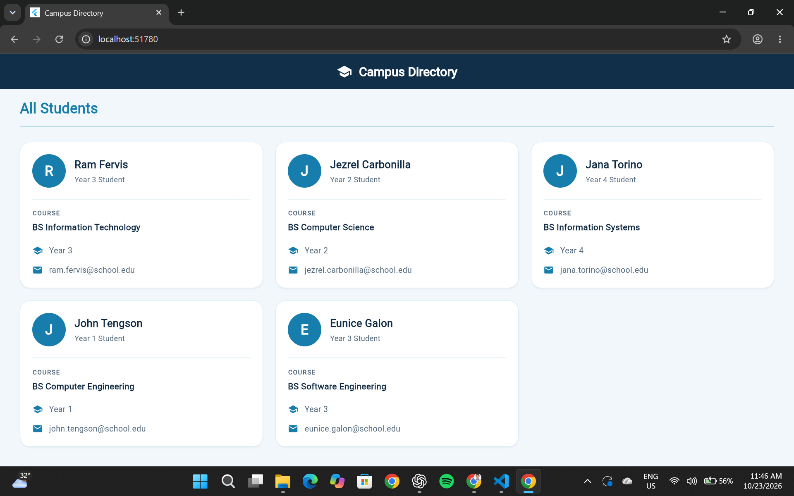

# Campus Directory

## Laboratory Activity 2: Building a Student Directory with Stateless Widgets

### Description
A Flutter application that displays student information in a clean, responsive campus directory.

### Features
- Student data model with final fields and a const constructor
- Five sample student records
- Reusable StatelessWidget components
- Student cards displaying names, courses, year levels, and email addresses
- Responsive layout for desktop, Chrome, and narrow screens
- Custom teal theme and styled student cards

### Technologies
- Flutter
- Dart
- Material Design 3

### How to Run
1. Install Flutter and configure your development environment.
2. Open the project folder in VS Code.
3. Run `flutter pub get`.
4. Run `flutter run -d chrome`.

### Screenshot

### Author
Ram Andre Fervis